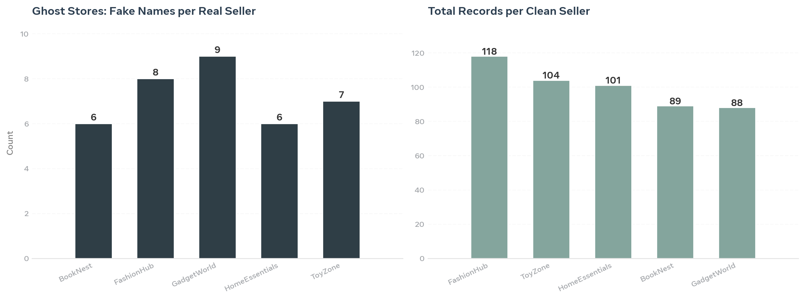

# Operation GhostStore - Banned Seller Resurrection Detection

**Detecting banned sellers creating ghost stores to evade marketplace bans.**

## Problem
500 raw records with 6 intentional obfuscation tricks:
- HTML tags: `<p>BookNest</p>`, `<b>GadgetWorld</b>`
- Emojis: `ToyZone🔥`, `FashionHub💥`
- Char substitution: `G@adgetWorld`, `F@shionHub`
- Case variance: `FASHIONHUB` vs `FashionHub.`
- Extra noise: `BookNest - Best Deals`, `  Gadget World  `

## My Solution (Python)
1. **Cleaning:** Regex to strip HTML, emojis, symbols
2. **Entity Resolution:** Mapped 36 dirty variants -> 5 true sellers
3. **Fraud Detection:** Grouped by bank/address fingerprints
4. **Visualization:** Matplotlib dashboard

## Results
- FashionHub: 8 fake names, 118 records
- GadgetWorld: 9 fake names, 88 records
- ToyZone: 7 fake names, 104 records
- **Total: 30 ghost accounts detected**
- Built 3 SQL queries to identify 1 pending appeal 670 days overdue (GadgetWorld)

## Files
- `Operation-GhostStore-RAW-MESSY.csv` - Raw messy data
- `GhostStore_CLEANED_By_Me.csv` - Cleaned data
- `dashboard.png` - Visual fraud dashboard
- `cleaning_code.py` - Full Python code

## Tech Stack
**Tech Stack:** Python, Pandas, SQL (MySQL - Appeals & Violations Join), Fraud Detection, Matplotlib

## How to Run
```bash
pip install -r requirements.txt
python cleaning_code.py
```

Author: Vaishali Desai | Learning Python for Trust & Safety
